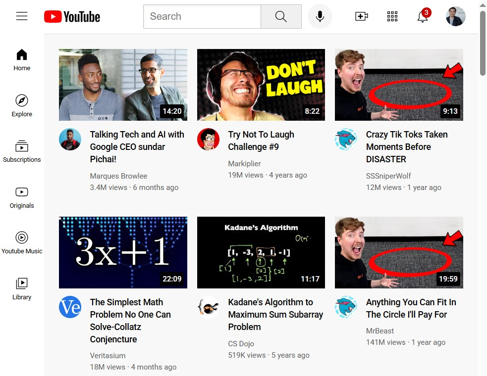

# YouTube Homepage UI Clone

A pixel-perfect, responsive replica of the YouTube homepage UI. This project was built to practice complex CSS layout techniques, modern positioning, and UI component structuring without reliance on external frameworks.

 

## 🚀 Live Demo
[View Live Demo](https://nibras-dev.github.io/your-repository-name/)

## 🛠️ Tech Stack
* **HTML5:** Semantic markup structure (header, main, nav, section, article).
* **CSS3:** Custom styles using modern layout modules (Flexbox & CSS Grid).

## ✨ Key Features & Technical Highlights
* **Responsive Video Grid:** Utilizes **CSS Grid** (`auto-fit` / `minmax`) to cleanly adjust thumbnail cards across different screen resolutions.
* **Sticky Navigation Bar:** Built with **Flexbox** for alignment, search bar input styling, and fixed positioning at the top of the viewport.
* **Sidebar Component:** Clean navigation drawer layout formatted for easy user accessibility.
* **Pixel-Perfect Alignment:** Precise spacing, custom scrollbar styling, and hover effects matching the actual YouTube interface.

## 💡 What I Learned
* Mastered combining **CSS Grid** for main content layouts alongside **Flexbox** for internal item alignment.
* Learned how to handle fixed header overlays without overlapping the main video feed using relative padding and positioning.
* Practiced structuring semantic HTML tags for modern web components.

## 👤 Author
* GitHub: [@Nibras-Dev06](https://github.com/Nibras-Dev06)